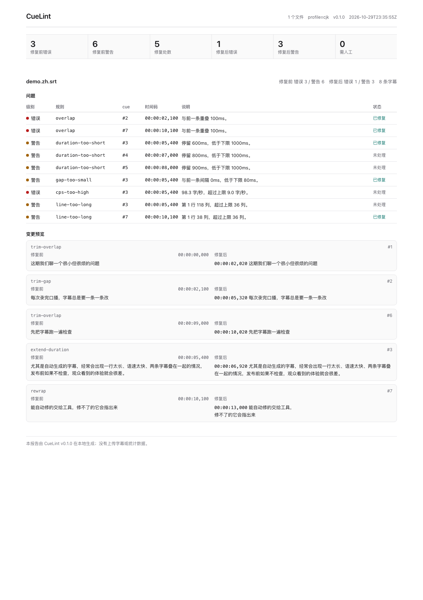
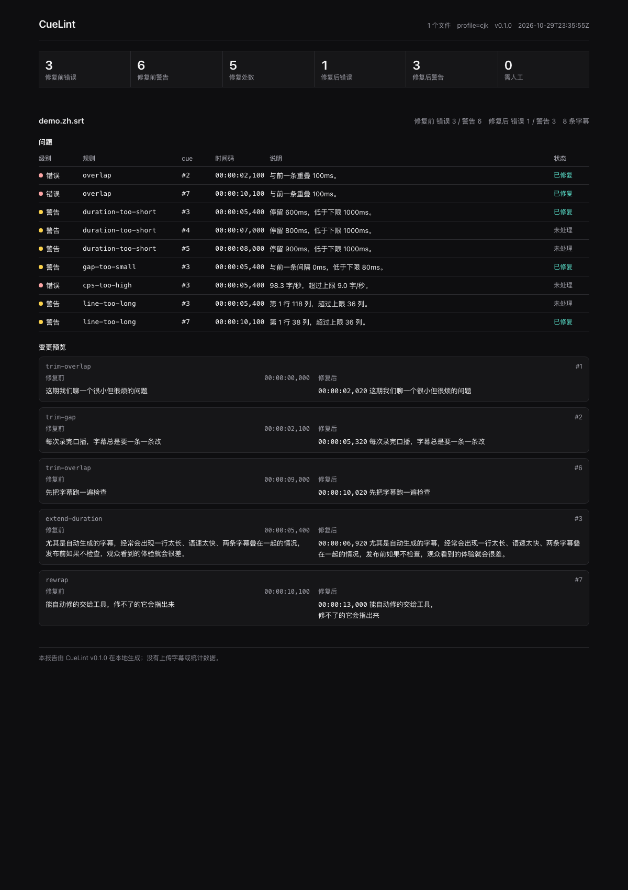
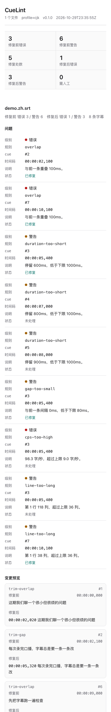

<p align="center"></p>

<h1 align="center">CueLint · 字幕体检</h1>

<p align="center">发布前把字幕检查一遍：能自动修的修掉，修不了的指出来。</p>

<p align="center">
  <a href="README_EN.md">English</a> ·
  <a href="#快速开始">快速开始</a> ·
  <a href="docs/features.md">功能</a> ·
  <a href="docs/development.md">开发</a> ·
  <a href="CHANGELOG.md">更新日志</a>
</p>

<p align="center">
  
  
  
  
  
</p>



CueLint 是一个本地命令行工具，检查 SRT / WebVTT 字幕并修掉能确定修好的问题：重叠、过短或过长的停留、过小的间隔、超宽行、过多行、语速过快、空字幕、重复字幕、控制字符和简单标记错误。报告是一个可直接打开的 HTML 文件，不联网、不上传、不需要账号，也不读取音视频。

它面向每周发 1–3 条口播视频、字幕来自自动识别或翻译的独立创作者和小团队。默认 `cjk` 档针对中文口播：36 列、2 行、9 字/秒。

## 它解决什么

自动字幕常见的问题不是“字错了”，而是“没法看”：

- 一行 100 多个字，铺满屏幕；
- 两条字幕重叠 100ms；
- 一句话只停 500ms，观众还没读完；
- 语速 20 字/秒，眼睛跟不上；
- 字幕里有 `&nbsp;`、控制字符或没闭合的 `<i>`。

CueLint 把这些问题变成可复现的检查项，并在不改变说话内容的前提下修复。无法在不破坏时间轴的情况下修好的，会留在报告里，标成“需人工”。

## 快速开始

需要 Python 3.11+。

```bash
# 推荐：隔离安装
pipx install .

# 或者只装到当前用户
pip install --user .

cuelint --version
cuelint check examples/demo.zh.srt
cuelint fix examples/demo.zh.srt --report demo-report.html
```

`fix` 默认生成 `examples/demo.zh.fixed.srt`，不覆盖原文件。打开 `demo-report.html` 可以看到修复前后的计数、每条问题的位置、原文摘录和修复预览。

## 常用命令

```bash
# 只检查，不写字幕；有问题时退出码 1
cuelint check episode-07.srt

# 检查并生成报告；默认 fail-on error
cuelint check episode-07.srt --report report.html

# 批量检查
cuelint check episodes/*.srt

# 修复；输出到同目录的 .fixed.srt
cuelint fix episode-07.srt --report report.html

# 输出到指定目录，或改后缀
cuelint fix episode-07.srt --out-dir fixed/ --suffix v2

# 覆盖已有输出
cuelint fix episode-07.srt --force

# 更严格的发布档
cuelint fix episode-07.srt --profile strict

# 机器可读输出
cuelint check episode-07.srt --format json

# 看某个规则为什么报、怎么修
cuelint explain cps-too-high
cuelint rules
cuelint profiles
```

退出码：`0` 通过；`1` 达到 `--fail-on` 阈值（默认 `error`）或仍有非法时长；`2` 参数、配置、输入或解析错误；`3` 输出已存在或不可写；`70` 未预期内部错误。JSON 错误统一为 `{"error": "...", "code": "..."}`。

## 四个档位

| 档位 | 行宽（列） | 行数 | 语速（字/秒） | 停留（ms） | 最小间隔（ms） |
|---|---:|---:|---:|---|---:|
| `latin` | 42 | 2 | 17.0 | 1000–7000 | 80 |
| `cjk`（默认） | 36 | 2 | 9.0 | 1000–8000 | 80 |
| `presentation` | 32 | 2 | 15.0 | 1500–6000 | 120 |
| `strict` | 37 | 2 | 15.0 | 1200–6000 | 120 |

这些是 CueLint 的默认值，不是某个平台的认证阈值。不同平台、不同观众、不同语速都可能需要调整；用 `--max-line-width`、`--max-cps` 等参数或 TOML 配置文件覆盖。详见 [docs/features.md](docs/features.md#档位与覆盖)。

## 报告

报告是单个自包含 HTML：没有外部字体、脚本、图片或网络请求；动态文本全部转义；CSP 为 `default-src 'none'; style-src 'unsafe-inline'; img-src data:`。浅色/深色跟随系统，375px 宽度下表格改为堆叠。问题超过 20 条时折叠，前 20 条默认展开。

<p align="center">
  
  
</p>

## 隐私与边界

- 不联网，不调用任何 API，不读取音视频，不写遥测。
- 不上传字幕；所有处理在本机完成。
- 不改变说话内容：修复只做删除空/重复字幕、删除控制字符、调整时间、断行、拆段。
- 不判断翻译质量、不纠正错别字、不做说话人分离、不生成字幕。
- 不能保证通过某个平台的审核；它只检查 CueLint 定义的 13 条规则。
- 对复杂 ASS/SSA、内嵌图形字幕、软字幕轨道不做处理；输入只支持 SRT 和 WebVTT。

## 适用与不适用

**适合**：口播、课程、访谈、播客视频；自动识别或翻译后的 SRT/VTT；发布前想快速过一遍字幕；需要离线、可重复、可进 CI 的检查。

**不适合**：需要逐帧对齐的专业字幕工作站；需要编辑样式、字体、位置的字幕；需要语音识别或翻译；需要处理 ASS/SSA 或图形字幕。

## 文档

- [功能与规则](docs/features.md)
- [开发与测试](docs/development.md)
- [外部依赖与数据格式](docs/external-apis.md)
- [与规格的偏差](docs/deviations.md)
- [部署与 CI](docs/deploy.md)
- [选题过程](docs/选题.md)
- [完整规格](SPEC.md) · [设计](DESIGN.md)
- [更新日志](CHANGELOG.md)

## 升级

```bash
pipx upgrade cuelint
# 或
pip install --user --upgrade .
```

0.x 阶段不保证跨小版本兼容；升级前看 [CHANGELOG.md](CHANGELOG.md)。

## 开发

```bash
git clone <this-repo> cuelint
cd cuelint
python3 -m venv .venv
. .venv/bin/activate
pip install -e '.[test]'
python -m pytest
```

测试不联网，全部在临时目录运行；连续三遍通过。当前 88 个用例，最近一次三遍均为 `88 passed`。

## 许可证

MIT，见 [LICENSE](LICENSE)。选择 MIT 而不是 AGPL：这是一个本地 CLI，价值在于被更多人安装和使用，没有需要通过网络服务回馈的 copyleft 场景；理由和取舍写在 [docs/deviations.md](docs/deviations.md#license)。
