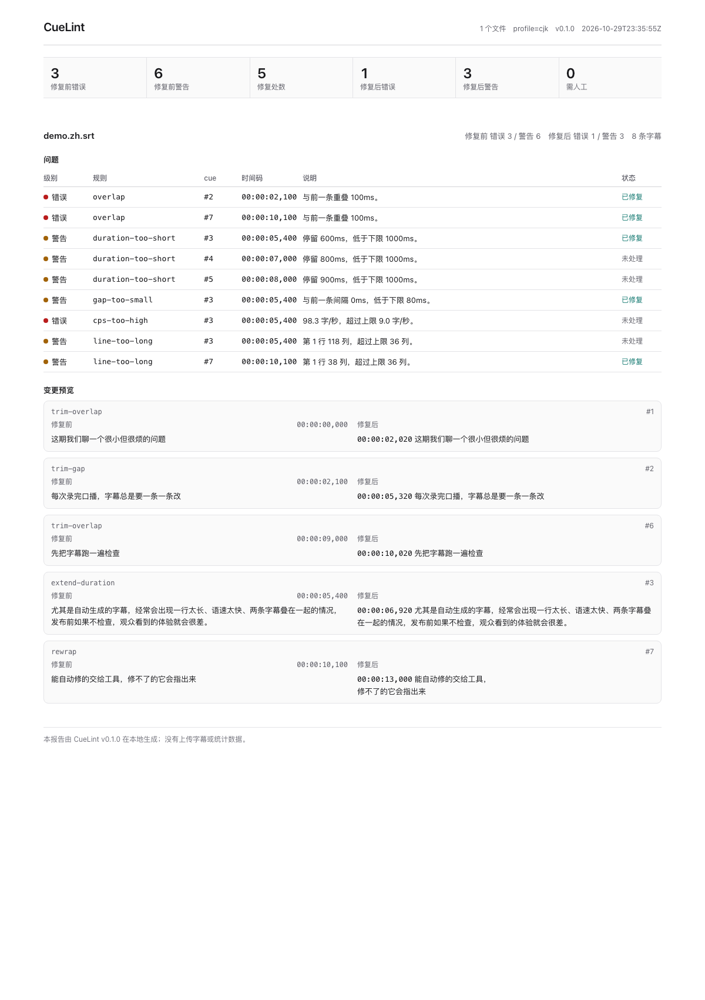
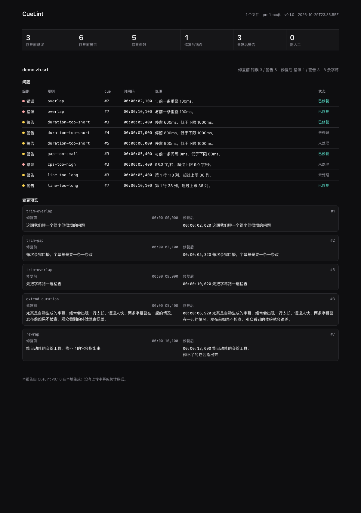
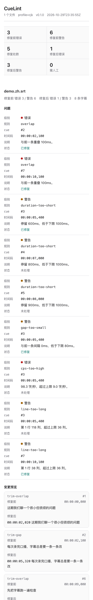

<p align="center"></p>

<h1 align="center">CueLint</h1>

<p align="center">Check subtitles before you publish: fix what can be fixed, and point at what cannot.</p>

<p align="center">
  <a href="README.md">中文</a> ·
  <a href="#quick-start">Quick start</a> ·
  <a href="docs/features.md">Features</a> ·
  <a href="docs/development.md">Development</a> ·
  <a href="CHANGELOG.md">Changelog</a>
</p>

<p align="center">
  
  
  
  
  
</p>



CueLint is a local command-line tool that checks SRT and WebVTT subtitles and fixes problems it can resolve deterministically: overlaps, cues that are too short or too long, gaps that are too small, lines that are too wide, too many lines, excessive reading speed, empty or duplicate cues, control characters, and simple markup errors. The report is a single self-contained HTML file. It does not use the network, upload anything, require an account, or read audio or video.

It is built for independent creators and small teams publishing one to three talking-head videos a week, with captions produced by automatic speech recognition or translation. The default `cjk` profile targets Chinese speech: 36 columns, 2 lines, 9 characters per second.

## What it solves

The problem with automatic captions is often not the words but the presentation:

- a 100-character line that fills the screen;
- two cues overlapping by 100 ms;
- a cue that stays for 500 ms, too short to read;
- 20 characters per second, faster than the eye can follow;
- stray control characters, `&nbsp;`, or unclosed `<i>`.

CueLint turns those into reproducible checks and repairs them without changing what was said. When a fix would break the timeline, the issue stays in the report marked "needs review".

## Quick start

Python 3.11+ is required.

```bash
# Isolated install (recommended)
pipx install .

# Or install for the current user
pip install --user .

cuelint --version
cuelint check examples/demo.zh.srt
cuelint fix examples/demo.zh.srt --report demo-report.html
```

`fix` writes `examples/demo.zh.fixed.srt`; it never overwrites the input. Open `demo-report.html` for before/after counts, issue locations, excerpts, and fix previews.

## Common commands

```bash
cuelint check episode-07.srt                 # check only; exit 1 on errors
cuelint check episode-07.srt --report r.html # write a report
cuelint check episodes/*.srt                 # batch
cuelint fix episode-07.srt --report r.html   # write .fixed.srt
cuelint fix episode-07.srt --out-dir fixed/ --suffix v2
cuelint fix episode-07.srt --force
cuelint fix episode-07.srt --profile strict
cuelint check episode-07.srt --format json
cuelint explain cps-too-high
cuelint rules
cuelint profiles
```

Exit codes: `0` pass; `1` `--fail-on` threshold reached (default `error`) or invalid timing remains; `2` usage, config, input, or parse error; `3` output exists or is not writable; `70` unexpected internal error. JSON errors are always `{"error": "...", "code": "..."}`.

## Profiles

| Profile | Width (cols) | Lines | CPS | Duration (ms) | Min gap (ms) |
|---|---:|---:|---:|---|---:|
| `latin` | 42 | 2 | 17.0 | 1000–7000 | 80 |
| `cjk` (default) | 36 | 2 | 9.0 | 1000–8000 | 80 |
| `presentation` | 32 | 2 | 15.0 | 1500–6000 | 120 |
| `strict` | 37 | 2 | 15.0 | 1200–6000 | 120 |

These are CueLint defaults, not a platform's certification threshold. Platforms, audiences, and speaking rates differ; override with `--max-line-width`, `--max-cps`, and related flags, or with a TOML config. See [docs/features.md](docs/features.md).

## Report

The report is one self-contained HTML file: no external fonts, scripts, images, or network requests. Dynamic text is escaped. Its CSP is `default-src 'none'; style-src 'unsafe-inline'; img-src data:`. Light and dark modes follow the system; at 375 px the table stacks. More than 20 issues are folded, with the first 20 shown.

<p align="center">
  
  
</p>

## Privacy and scope

- No network, no APIs, no audio or video reading, no telemetry.
- Subtitles never leave the machine.
- Speech content is not changed: fixes remove empty/duplicate cues and control characters, adjust timing, wrap lines, and split cues.
- It does not judge translation quality, correct typos, perform speaker diarization, or generate captions.
- It cannot guarantee approval by any platform; it checks the 13 CueLint rules.
- ASS/SSA, bitmap subtitles, and embedded subtitle tracks are out of scope. Input is SRT and WebVTT only.

## When it fits

**Good fit:** talking-head videos, courses, interviews, and podcasts; SRT/VTT from ASR or translation; a quick pre-publish pass; offline, repeatable checks in CI.

**Not a fit:** frame-accurate professional subtitle workstations; editing styles, fonts, or positions; speech recognition or translation; ASS/SSA or bitmap subtitles.

## Docs

- [Features and rules](docs/features.md)
- [Development and testing](docs/development.md)
- [External dependencies and formats](docs/external-apis.md)
- [Deviations from the spec](docs/deviations.md)
- [Deployment and CI](docs/deploy.md)
- [Full specification](SPEC.md) · [Design](DESIGN.md)
- [Changelog](CHANGELOG.md)

## Upgrade

```bash
pipx upgrade cuelint
# or
pip install --user --upgrade .
```

0.x releases do not guarantee compatibility across minor versions; read [CHANGELOG.md](CHANGELOG.md) before upgrading.

## Development

```bash
git clone <this-repo> cuelint
cd cuelint
python3 -m venv .venv
. .venv/bin/activate
pip install -e '.[test]'
python -m pytest
```

Tests use no network and run entirely in temporary directories. The current suite has 88 tests and passed three consecutive runs.

## License

MIT, see [LICENSE](LICENSE). MIT was chosen over AGPL because this is a local CLI whose value grows with adoption, and there is no network-service copyleft concern; the rationale is in [docs/deviations.md](docs/deviations.md#license).
